# Oswaldo Moper 

Mathematician with interest in programming, arts and Formula 1.
Currently learning to sing and to edit audio (WIP, expect bugs).

I like building reproducible, clean and non-complex things (systems, projects and relationships)
I want to understand weird side-effects and magic stacks, or refactor them.

## 🛠️ What I've built

- **[NixosConfig](https://github.com/OswaldoMoper/NixosConfig)**: NixOS modules for several users, machines and apps, with gated deploys, PostgreSQL and monitoring.
- **[dashboardF1](https://github.com/OswaldoMoper/dashboardF1)**: a live Formula 1 dashboard with a Servant backend, a Reflex frontend and Python telemetry.
- **[cattleServer](https://github.com/OswaldoMoper/cattleServer)**: automatic PostgreSQL and file backups for several apps.

📄 [My CV (in Spanish)](https://oswaldomoper.com/cv/)

## 🧠 Skills & Tech Stack

- **Haskell** (Cabal, Nix, Yesod, Lucid)
- **Nix/NixOS** (flakes, moderate reproducibility)
- **SQL** (PostgreSQL enjoyer)
- **HTML/CSS** (Without unnecessary frameworks)
- **Audio mixing** (Learning)
- **Singing** (Waiting for feedback)

## 🐞 Known Bugs (WIP)

- I tend to explain everything when I get excited...
- If something works, it could work better!
- If there's F1, I'm out of office.
- I tell bad jokes at good times, "*Me llaman comedio*" (*Spanish pun, sorry*)
- Occasional overengineering (but without losing the car).
- There is no talk about the 2025 drivers' championship.

## 💬 Ask me about…

- Haskell
- Nix/NixOS
- SQL
- HTML/CSS
- Why Piastri should be Formula 1 world champion
- Why you should focus on consistency rather than speed

## 🧪 Languages and Tools

## 🗂️ Roadmap

- [ ] Improve vocal technique
- [ ] Write a more technical/professional README 😅
- [ ] [Make a video explaining Nix](https://www.youtube.com/channel/UCxqUz5G9gsAvMdxPxmwoHHg)
- [ ] Learn to audio mixing without losing
- [ ] Go to an F1 GP

## 🔐 License

I have secrets, handled with 2-Factor Authentication.
Pull Requests are welcome, but require going through CI:

- Interesting conversations
- No bullshit
- Mutual respect

## 🧾 Contact

If you want to collaborate or to connect with me:

- open an issue,
- send me DM,
- or invite me for a coffee
